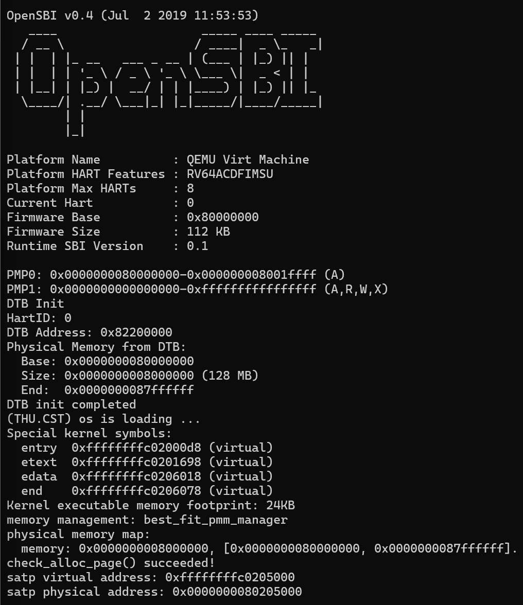
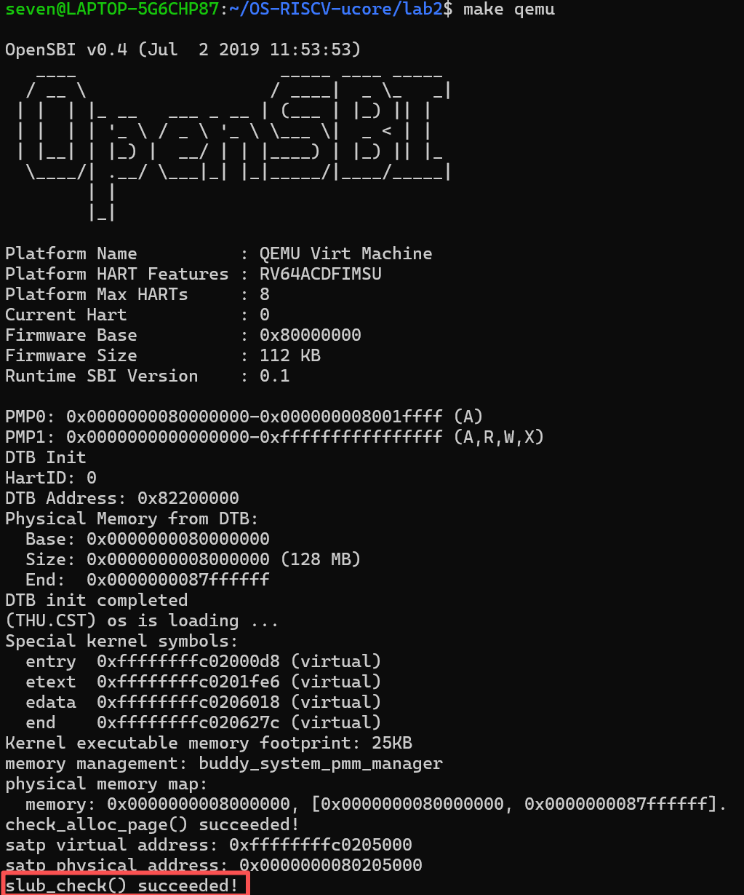

# Lab2 实验报告：物理内存管理

## 一、实验整体逻辑

本章在 lab1"直接物理寻址"的可启动系统上，按"先能安全地访问内存，再能发现内存，最后能分配内存"的顺序推进，围绕两大功能逐步展开：一是物理内存初始化（发现内存并建立管理所需的数据结构），二是物理内存分配（在空闲页上实现可替换的分配算法）。页表机制的引入是这两者的前提，因为内核要先进入虚拟内存访问模式，后续的内存管理才能在一个稳定的地址空间中进行。

实现顺序可以拆成六步。第一步，引入分页：修改 `tools/kernel.ld` 把内核链接基址迁移到虚拟高地址 `0xffffffffc0200000`，由 `entry.S` 在启动早期构造一张只含一个有效项的三级页表（以 1 GiB 大页完成映射），随后写 `satp` 并执行 `sfence.vma` 刷新 TLB，内核自此以"虚拟高地址取指、物理低地址存放"的方式运行。第二步，物理内存探测：OpenSBI 在启动时扫描硬件并以 DTB 格式保存结果，地址经 `a1` 寄存器移交内核，`entry.S` 将其存入 `boot_dtb`，`dtb_init()` 解析出物理内存基址与大小，供后续查询。第三步，建立管理框架：`struct pmm_manager` 用函数指针把"初始化、登记空闲区、分配、释放、查询、自检"六个操作抽象成接口，`init_pmm_manager()` 负责选择具体算法，`pmm.c` 中的 `alloc_pages()` / `free_pages()` 等只做转发，实现接口与实现的解耦。第四步，初始化物理页：`page_init()` 依据设备树信息建立 Page 描述符数组的布局，把内核镜像与描述符数组排除在外，再通过 `init_memmap()` 把剩余完整空闲页注册给当前管理器。第五步，实现分配算法：以 `default_pmm.c` 的 First-Fit 为参照实现 Best-Fit，并在 `init_pmm_manager()` 中切换。第六步，验证与收尾：`check_alloc_page()` 对分配路径做自检，`pmm_init()` 末尾输出 satp 的虚拟与物理地址，确认分页映射与实际布局一致。

贯穿这条链的核心数据结构是 Page 描述符与空闲链表：前者把每 4 KiB 物理页抽象成一个可追踪状态的对象，后者把空闲连续块组织成可分配的资源。整体实现链即指导书所概括的 `pmm_init() -> init_pmm_manager() -> page_init() -> init_memmap() -> alloc_pages()/free_pages()`。

## 二、功能模块一：物理内存初始化功能

### 任务一：物理内存探测与页描述符初始化

**实现思路**

`page_init()` 的职责是根据设备树提供的物理内存信息建立可管理物理页的描述符布局，并把排除 OpenSBI、内核镜像和描述符数组占用空间后的完整空闲页面交给当前 `pmm_manager`。实现时首先区分四个容易混淆的地址概念：虚拟地址（内核当前视角，等于物理地址加固定偏移）、物理地址（硬件视角）、物理页号（物理地址右移 12 位）和 Page 描述符地址（`pages` 数组中某项的虚拟地址）。

实现步骤如下。第一，设置虚实映射偏移 `va_pa_offset = PHYSICAL_MEMORY_OFFSET`，后续所有地址换算都通过它完成。第二，调用 `get_memory_base()` 与 `get_memory_size()` 从设备树取得物理内存的基址与大小，并对结果做合法性校验：基址或大小为零、或两者相加发生回绕，说明设备树信息无效，此时调用 `panic()` 终止初始化。第三，打印探测到的物理内存范围。第四，计算可管理上界 `maxpa`：若设备树报告的内存末端超过框架规定的 `PHYSICAL_MEMORY_END`，则截断到该上界，防止管理到不存在的物理地址；`npage = maxpa >> PGSHIFT` 给出物理页总数。第五，将描述符数组 `pages` 放置在链接符号 `end`（内核镜像末尾）之后并按页对齐；从 `nbase` 到 `npage` 的每一页描述符先全部置为 `PageReserved`，保证内核镜像与描述符数组自身不会进入空闲区。第六，计算第一个可空闲的物理地址：描述符数组末尾经 `PADDR` 转为物理地址后再向上取页对齐，作为空闲区起点；空闲区终点为设备树报告内存末端向下取页对齐（同样不越过 `maxpa`）。起点小于终点时，调用 `init_memmap(pa2page(freemem), (mem_end - freemem) / PGSIZE)` 把这段完整空闲页注册给当前管理器；若没有完整页面可用，则不调用 `init_memmap()`。

**核心函数与功能模块的理解**

本节涉及的功能可以拆成四个相互配合的部分，各自的核心职责如下。

物理内存探测模块（`kern/driver/dtb.c`）是信息的来源。OpenSBI 完成硬件扫描后把 DTB 的物理地址放在 `a1` 寄存器中交给内核，`dtb_init()` 校验设备树魔数、解析 `/memory` 节点，把物理内存基址与大小存入全局变量，`get_memory_base()` 与 `get_memory_size()` 向外提供只读查询。内核自身不做硬件扫描，这是"固件移交内存图"思想在本实验中的体现。

页描述符与转换机制是管理的载体。`struct Page` 中，`ref` 是引用计数，`flags` 记录保留、空闲块首页两个状态位，`property` 记录空闲连续块的页数，`page_link` 把描述符挂进空闲链表；配合 `PADDR` / `KADDR` 完成虚实地址换算，`pa2page()` / `page2pa()` 在物理页号与描述符之间互转。`le2page()` 利用"结构体内存连续布局"从链表节点指针反推描述符首地址，即 Linux 中常见的 container_of 技巧——遍历时手里只有 `list_entry`，必须减掉 `page_link` 成员的偏移才能拿到完整的 `Page`。

`page_init()`（`kern/mm/pmm.c`）是本任务的核心函数，职责是连接"探测结果"与"分配器"：建立描述符布局并注册初始空闲区。成功返回时必须正确设置三个全局量：`va_pa_offset`（虚实映射偏移，后续所有地址换算的前提）、`npage`（可管理物理页号上界）和 `pages`（描述符数组首地址）；并输出探测到的内存范围、完成当前管理器初始空闲区的注册。函数内部的关键决策是排除策略：内核镜像、描述符数组、不足一页的尾部都不能进入空闲区，其余完整页面才通过 `init_memmap()` 交出。

管理器框架（`kern/mm/pmm.c` 与 `kern/mm/pmm.h`）是转发与解耦层。`struct pmm_manager` 用函数指针定义六个操作：`init` 初始化内部结构，`init_memmap` 接收一段可用页，`alloc_pages` / `free_pages` 分配与回收连续页，`nr_free_pages` 查询空闲总数，`check` 自检。`pmm.c` 中的同名函数不实现算法，只调用当前 `pmm_manager` 指针指向的回调。`page_init()` 调用的 `init_memmap()` 实际执行的是当前管理器（本实验中为 Best-Fit）的 `init_memmap`——这正是模块一与模块二的接缝：初始化不关心算法细节，只保证传入的状态描述正确。

**关键调试经历**

初版 `page_init()` 完成后首次联调，构建成功但 QEMU 运行未通过分配检查。排查定位为 Best-Fit 模块尚未完成：`kern/mm/best_fit_pmm.c` 中框架只提供了 `basic_check()` 与 `best_fit_check()` 两个测试函数，管理器的 `init_memmap()`、`alloc_pages()` 等回调还是空实现，`init_pmm_manager()` 切换到 `best_fit_pmm_manager` 后，`page_init()` 注册的初始空闲区没有可用的分配路径，`check_alloc_page()` 无法通过。由于该模块由同组同学负责实现，本次联调的结论是先固定已验证的初始化部分，等待 Best-Fit 模块合入后再整体复测。

同学完成 Best-Fit 实现并合入后，重新构建运行，初始化输出与分配检查一次通过，关键输出见下。这段经历也说明模块一与模块二通过 `init_memmap()` 接口解耦：只要空闲区注册的状态正确，管理器实现的替换不影响初始化部分的既有验证结果。

**构建与验证结果**

修复后重新构建并运行，内核打印探测到的内存范围，并通过分配检查：

```text
physical memory map:
  memory: 0x0000000008000000, [0x0000000080000000, 0x0000000087ffffff].
check_alloc_page() succeeded!
```

### 扩展任务 Challenge：硬件可用物理内存范围的获取方法

如果操作系统无法提前知道硬件的可用物理内存范围，常见的获取办法可以按信息来源分为三类。

第一类是由固件移交内存图，也是现代系统的主流做法。本实验即属此类：OpenSBI 固件在启动时解析设备树（DTB），内核再经由 `get_memory_base()` 等接口读取 `/memory` 节点中的基址与大小。x86 平台上对应机制是 BIOS 的 `int 15h, e820` 调用或 UEFI 的 `GetMemoryMap` 接口，它们还会区分"可用内存"与"保留内存"等区域类型。固件移交的优点是可靠、无破坏性，且能给出内存的保留区域等元信息。

第二类是固件运行时的查询接口。部分固件提供启动阶段的系统信息查询服务，操作系统可在早期引导时调用。RISC-V 的 SBI 规范本身没有直接查询内存总量的调用，因此该平台实际上仍依赖设备树；若固件不提供，则操作系统只能退而求其次。

第三类是操作系统自行探测，仅作为没有固件信息时的兜底手段。基本思路是从低地址向高地址逐个区域写入特征数据再读回，通过数据是否保持、是否发生地址别名或回绕，判断该段物理内存是否真实存在。这种方法有明显缺陷：写入探测是破坏性的，会覆盖未知区域中的数据；遇到内存映射 I/O 区域可能触发设备副作用；带 ECC 的机器上还可能因错误注入而误判。因此实际系统几乎不采用纯探测方式。

综上，让固件在启动早期移交一份内存图，是兼顾可靠性、安全性与信息丰富度的标准方案。

## 三、功能模块二：物理内存分配功能

### 任务一：理解 First-Fit 连续物理内存分配算法

First-Fit 分配器把空闲页组织成一条按物理地址递增排列的双向链表，每个链表节点是某个空闲连续块的首页描述符，该页置 `PageProperty` 标志，其 `property` 字段记录块内页数；全局计数 `nr_free` 记录空闲页总数。以下按 `kern/mm/default_pmm.c` 的四个核心函数说明其工作过程。

`default_init()` 完成管理器的初始状态：将空闲链表置为空链表，把空闲页计数清零，表示尚未接收任何可分配页面。

`default_init_memmap(base, n)` 接收一段连续空闲页并完成登记。实现先将这 `n` 页的描述符逐个清除 `PageReserved`、引用计数清零，随后把首页的 `property` 置为 `n` 并设置 `PageProperty`，再将该首页按地址顺序插入空闲链表，最后把 `nr_free` 增加 `n`。经过此函数，一段物理内存就被描述为链表中的一个空闲块。

`default_alloc_pages(n)` 执行分配。先检查请求页数是否合法且不超过空闲总数；然后从链表头开始顺序扫描，找到第一个页数不小于 `n` 的空闲块。若该块恰好等于 `n` 页，直接把它从链表摘除；若大于 `n` 页，则从块首切出 `n` 页，把剩余部分的首页重新登记为一个更小的空闲块（更新其 `property` 并留在链表中）。无论哪种情况，被分配块的首页都会清除 `PageProperty`，`nr_free` 减少 `n`。由于链表按地址排列，First-Fit 自然优先使用低地址的空闲块。

`default_free_pages(base, n)` 执行回收与合并。实现先把待释放的 `n` 页引用计数清零，首页 `property` 置为 `n` 并设置 `PageProperty`，再按地址顺序插回空闲链表，随后分别检查其物理地址上的前驱块与后继块是否相邻：若前驱块的末尾恰等于本次释放区的起点，或后继块的起点恰等于释放区的末尾，就把相邻块从链表摘下并合并为一个更大的空闲块。由于空闲块始终按地址有序，任何时刻链表中不存在两个物理相邻的独立空闲块，碎片被控制在"不相邻的小块"这一形态。

First-Fit 仍有改进空间。其一，分配与插入都需要从头顺序扫描链表，空闲块较多时查找成本为线性；可以为空闲块引入按大小分类的多条链表或平衡树索引，将"找第一个足够大的块"降为近似对数时间。其二，First-Fit 倾向于反复使用低地址区域，低地址容易先被切碎，碎片分布不均；轮转起点（next-fit）或从上次分配位置继续扫描可缓解这一问题。其三，释放时的合并依赖地址有序链表，合并代价与块数成正比；采用边界标签或伙伴系统一类的结构化管理方式，可以把"查找可合并邻居"的成本降下来，代价是实现复杂度与额外元数据。


### 任务二：实现 Best-Fit 连续物理内存分配算法

#### 1. 核心函数与功能模块的理解

Best-Fit 与 First-Fit 使用相同的页管理框架，区别在于候选块的选择：First-Fit 选择遍历中第一个足够大的块，Best-Fit 则在全部候选块中选择最小的满足块。本任务以 `kern/mm/default_pmm.c` 为参考，在 `kern/mm/best_fit_pmm.c` 中实现管理函数和 `best_fit_pmm_manager`，再通过 `kern/mm/pmm.c` 的 `init_pmm_manager()` 接入内核。

内部使用 `free_area_t` 保存按物理地址递增的空闲块链表和空闲页计数。每个节点表示空闲块首页，该页的 `PageProperty` 标志表示它是空闲块头，`property` 记录块内页数。链表和计数使用已有测试访问的 `free_list`、`nr_free`，保证测试操作的状态就是分配器实际使用的状态。

- `best_fit_init()`：初始化空链表，将空闲页数清零。
- `best_fit_init_memmap(base, n)`：清除可用页的保留状态和引用计数，建立块首页描述，按地址插入并与相邻空闲块合并。
- `best_fit_alloc_pages(n)`：遍历全部空闲块，选择 `property >= n` 且 `property` 最小的块。从块首分配，剩余部分重新登记；扣减空闲页数，清除分配块首页的空闲块标志。
- `best_fit_free_pages(base, n)`：清理页面状态与引用计数，按地址插回释放区间，再分别检查前驱、后继是否物理连续并合并。
- `best_fit_nr_free_pages()`：返回当前空闲页总数，不修改状态。

`best_fit_pmm_manager` 将上述函数绑定到框架回调，将 `check` 绑定到原有 `best_fit_check()`。这样页面初始化和后续分配、释放都能通过公共接口调用 Best-Fit。

#### 2. Spec 的设计

编写 spec 时，先从 `pmm_manager` 提取需要交付的接口，再从 `Page` 和已有检查函数提取状态约定，最后按函数写出 `Pre-Condition`、`Post-Condition`，对分裂、失败等分支补充 `Case`。规格描述应达到什么状态，具体的链表操作放在实现说明中。

| 接口 | 前置条件 | 后置条件与边界情况 |
| --- | --- | --- |
| 初始化 | 管理器尚未接收可用页 | 空闲链表为空，空闲页数为零 |
| 登记空闲区 | 管理器已初始化，`n > 0`，连续 `n` 页可交给管理器且处于保留状态 | 引用计数清零，页面加入空闲管理，空闲页数增加 `n`，块头标志和块大小正确 |
| 分配连续页 | `n > 0`，管理器状态有效 | 成功时交出连续 `n` 页，空闲页数减少 `n`；候选块大于请求则保留余块；多个块可用时选择最小满足块 |
| 分配失败 | 链表为空或没有单个连续块能满足请求 | 返回 `NULL`，不改变链表和计数，不能拼接不连续块 |
| 释放页面 | 页面已分配且未保留，`n > 0` | 页面重新空闲，引用计数清零，空闲页数增加 `n`，相邻空闲块合并 |
| 查询与注册 | 管理器已初始化 | 查询返回真实空闲页数；各回调绑定正确，启动选择 Best-Fit |

贯穿各接口的不变量是：链表节点均为空闲块首页，块之间互不重叠，`PageProperty` 与 `property` 正确描述块边界，所有空闲块页数之和等于 `nr_free`。

已有 `best_fit_check()` 还会暂时清空链表，再更新计数。因此 spec 特别规定空链表必须返回 `NULL`，不能仅凭暂存的空闲页计数判断分配成功。这一约束直接来自实际测试代码。

#### 3. Prompt 的设计

提示词按 lab0.5 的四段式格式组织，粒度为“完整 Best-Fit 管理模块及其注册”，使初始化、分配、释放和状态维护在同一份上下文中完成。

| 部分 | 本任务填写的内容 | 设计目的 |
| --- | --- | --- |
| `[PROMPT]` | 指明 `best_fit_pmm.c` 的任务标记、`pmm.c` 的注册位置，要求修改真实文件、保留既有逻辑并说明结果 | 限定目标与修改范围 |
| `[RELY]` | 提供真实的 `pmm_manager`、`Page`、链表、引用计数接口，以及测试对 `free_list`、`nr_free` 的访问约定 | 避免生成不存在的接口或独立于测试的另一套状态 |
| `[GUARANTEE]` | 列出五个管理回调、管理器注册结构和 `init_pmm_manager()` 的接入要求 | 明确交付函数及接入位置，禁止修改两个已有测试函数 |
| `[SPECIFICATION]` | 按上述前后置条件、不变量及成功/失败分支描述行为 | 使实现结果能通过断言和状态变化核对 |

关键提示词摘录如下，完整内容见 [Best-Fit 提示词](lab2-best-fit-prompt.md)：

> 不得修改 `basic_check()` 和 `best_fit_check()`；分配器实际使用的状态必须与测试操作的 `free_list` 和 `nr_free` 一致。

> 有多个空闲块能够满足请求时，选择页面数最接近请求大小且不小于请求大小的块；失败时返回 `NULL`，空闲管理状态不因失败而改变。

#### 4. 测试方法、结果与有效性

启动时 `check_alloc_page()` 调用当前管理器的 `check` 回调，Best-Fit 对应 `best_fit_check()`，后者还会执行 `basic_check()`。基本检查验证单页分配结果互不相同、页面引用计数正确、空链表分配失败以及释放后的重新分配。

Best-Fit 专项检查将五页测试区域中的两页块和一页块分别释放，再申请一页，并断言返回一页块的位置。这个断言能区分 Best-Fit 与简单按地址选择的 First-Fit。检查还验证碎片状态下无法满足连续四页请求、页面释放后恢复五页连续块，以及测试结束时链表块数和空闲页总数恢复。

已有截图记录的关键输出为：

```text
memory management: best_fit_pmm_manager
check_alloc_page() succeeded!
```



这里的结果来自已有截图，本次报告整理未重新运行构建或测试。内核符号地址、镜像大小和页表地址会随代码布局变化，与指导书示例不完全一致不代表分配算法出错。

#### 5. 思考题：Best-Fit 是否还有改进空间

当前实现每次分配遍历全部空闲块，时间复杂度为 `O(k)`，其中 `k` 是空闲块数量。可以为块大小增加有序索引或分类链表，减少寻找最小满足块的成本；代价是在分裂和合并时同步维护地址关系与大小索引。对恰好匹配请求的块也可以提前停止扫描。

Best-Fit 虽然减少了单次分配的剩余空间，却可能留下许多难以利用的小碎片。因此还可研究最小分裂阈值等策略，但若改变实际分配大小，就必须同时调整释放和计数约定，不能直接破坏本实验按 `n` 页分配、释放的接口语义。

### 任务三：Buddy System（伙伴系统）分配算法

**实现思路与核心函数**

本任务在 `kern/mm/buddy_system_pmm.c` 和 `kern/mm/buddy_system_pmm.h` 中实现并声明 Buddy System 管理器，再在 `kern/mm/pmm.c` 的 `init_pmm_manager()` 中选择 `buddy_system_pmm_manager`。它与前一任务的 Best-Fit 共用 `struct pmm_manager` 接口，因而 `pmm.c` 的公共分配入口不需要为 Buddy 另设一套接口；当前内核选择 Buddy，原有 Best-Fit 实现与测试保留。Makefile 会自动收集 `kern/mm` 下的 C 文件，新增实现能够直接参与构建。

管理器用 `buddy_areas[BUDDY_MAX_ORDER]` 按阶维护空闲链表，`BUDDY_MAX_ORDER` 为 32，对应阶数 0 至 31；`buddy_nr_free` 记录实际空闲页数。阶数 `k` 的块包含 `2^k` 个连续物理页，块首页的物理页号需按 `2^k` 对齐。块首页的 `PageProperty` 标志表示它是空闲块首页，`property` 保存阶数；分配后首页仍保存该阶数，以便释放时还原整个伙伴块。这里 `property` 的意义是阶数，不同于 First-Fit、Best-Fit 将它用作页数。

`buddy_init()` 初始化每阶链表并清零空闲页数。`buddy_init_memmap(base, n)` 检查输入页面均为保留页面，清理状态和引用计数，再按物理页号对齐约束把区间拆成尽可能大的二次幂块登记。这样长度不是二次幂或起点未对齐时也能覆盖输入区间，且不把范围外页面加入管理。

`buddy_alloc_pages(n)` 找到能够容纳请求的最小阶数，从该阶或更高阶的非空链表取块；若块较大，就逐级拆分，保留左半块继续分配、将右半块登记到相应阶。请求 3 页会向上取整为 4 页，空闲计数也按 4 页扣减。请求超过可用页数或没有足够大的连续伙伴块时返回 `NULL`，不改变空闲状态。

`buddy_free_pages(base, n)` 根据首页保留的阶数确定实际块大小，检查 `n` 为正且不大于该块大小，并确认块内页面没有保留或仍登记为空闲，然后清理页面状态和引用计数，归还完整伙伴块。由此，`free_pages()` 要求 `base` 是原分配返回的块首页；对 3 页请求分配出的 4 页块，按 3 页参数释放时会归还完整 4 页。归还时以 `ppn XOR (1 << order)` 计算物理伙伴，只有伙伴在 `[nbase, npage)` 范围内且为空闲的同阶块才合并，合并后继续检查更高阶伙伴。`buddy_nr_free_pages()` 返回实际空闲页数，管理器的 `check` 回调指向 `buddy_check()`。

**spec 的设计**

spec 按管理器初始化、可用区间登记、分配、释放、空闲页数查询和自检分别说明前置与后置条件。核心不变量是：第 `k` 阶链表中的首页标志和 `property` 必须与该阶相符，物理页号满足块对齐；空闲块互不重叠，所有阶表示的页数之和等于空闲页数；范围外、非空闲或不同阶的页面不能作为伙伴合并。

分配规格说明向上取整、逐阶拆分及资源不足时返回 `NULL` 且状态不变；释放规格说明仅接受原伙伴块首页，并按记录的阶数归还完整块。自检规格则要求先隔离测试区域，结束后恢复链表连接、页面标志和计数，并归还预留块。异常或边界场景只写入与当前接口能够保证的行为，不假设实现支持任意子块释放。

**prompt 的设计与原文**

本任务依照指导书的四段式框架组织 prompt：`[PROMPT]` 说明目标文件、操作范围和输出；`[RELY]` 列出从项目中核实的结构、函数与地址约定；`[GUARANTEE]` 列出必须实现或修改的接口；`[SPECIFICATION]` 按函数说明前置条件、后置条件、执行分支和特殊约束。第一份 prompt 用于实现并接入分配器，第二份针对实现设计内核自检。以下为本任务使用的原文。

第一份：生成并接入 Buddy System。

````text
[PROMPT]
**任务**：在 `lab2/kern/mm/buddy_system_pmm.c` 和 `lab2/kern/mm/buddy_system_pmm.h` 中实现 Buddy System 物理页分配器，并在 `lab2/kern/mm/pmm.c` 中接入该管理器。

**操作要求**：先阅读下方 RELY 列出的真实接口及相关实现，再直接修改项目文件，不要只输出代码片段。保留现有 First-Fit、Best-Fit 实现及测试；不要修改 `struct pmm_manager`、`struct Page` 或公共分配接口。新增辅助函数和状态限于 Buddy 模块内部。

**输出要求**：实现后说明初始化、分配、释放和伙伴合并的行为，指出实现与接口约定的边界，并报告实际构建和运行检查结果。若本提示与项目真实代码不一致，以真实代码为准并指出差异。

[RELY]
- `kern/mm/pmm.h` 定义 `struct pmm_manager`，其回调为 `init(void)`、`init_memmap(struct Page *base, size_t n)`、`alloc_pages(size_t n)`、`free_pages(struct Page *base, size_t n)`、`nr_free_pages(void)` 和 `check(void)`。
- `kern/mm/memlayout.h` 中的 `struct Page` 含 `ref`、`flags`、`property` 和 `page_link`；`PageReserved`、`PageProperty`、`SetPageReserved`、`SetPageProperty`、`ClearPageProperty` 用于检查和修改页面状态。`property` 是管理器可用的块描述字段，具体语义由所选分配器维护。
- `pmm.h` 提供 `pages`、`nbase`、`npage`，以及 `page2ppn()`、`pa2page()`、`page2pa()` 等页面号与描述符转换接口。`page2ppn(page)` 对应物理页号 `page - pages + nbase`；可管理页号范围为 `[nbase, npage)`。
- `libs/list.h` 提供双向循环链表的初始化、插入、删除和空表检查操作；`pmm.h` 提供页面引用计数操作。
- `kern/mm/default_pmm.c` 和 `kern/mm/best_fit_pmm.c` 展示现有分配器如何初始化页面、维护空闲状态及注册 `pmm_manager` 回调。
- `kern/mm/pmm.c` 的 `init_pmm_manager()` 选择并初始化当前管理器；后续页面初始化通过 `init_memmap()` 把可用页面交给当前管理器。Makefile 自动收集 `kern/mm` 下的 C 文件。
- 对 Buddy 接口，传给 `init_memmap()` 的页面应处于保留状态。`alloc_pages(n)` 要求正数请求；释放时 `base` 是原分配返回的块首页，`n` 为正且不大于该伙伴块的实际页数，分配器须按原块大小归还。

[GUARANTEE]
必须实现或修改的接口：
```c
static void buddy_init(void);
static void buddy_init_memmap(struct Page *base, size_t n);
static struct Page *buddy_alloc_pages(size_t n);
static void buddy_free_pages(struct Page *base, size_t n);
static size_t buddy_nr_free_pages(void);
static void buddy_check(void);
extern const struct pmm_manager buddy_system_pmm_manager;
```

在 `kern/mm/pmm.c` 中修改 `init_pmm_manager()`，使其选择 `buddy_system_pmm_manager` 并调用 `init()`。可增加 Buddy 模块内部的 `static` 辅助函数、宏和状态，不新增公共接口。

[SPECIFICATION]
## buddy_init
**Pre-Condition**: Buddy 管理器尚未接收可分配页面。

**Post-Condition**: 各阶空闲链表均为空，空闲页计数为零。

## buddy_init_memmap
**Pre-Condition**: `n > 0`；`base` 开始的 `n` 个描述符均为保留页面。

**Post-Condition**: 恰好将输入区间内的页面纳入管理；清理这些页面的保留标志、块描述和引用计数；所有空闲块均按物理页号对齐且互不重叠，空闲页数增加 `n`。

**Case 1**: 输入长度不是 2 的幂或起点不满足大块对齐时，将区间拆成多个最大可用的对齐二次幂块；不得接收输入区间之外的页面。

## buddy_alloc_pages
**Pre-Condition**: `n > 0`，管理器已初始化。

**Post-Condition**: 成功时返回一个至少容纳 `n` 页的块首页；请求按最小容纳阶数向上取整，计数按实际分配块大小减少。被分配块不再登记为空闲，拆分产生的另一半仍正确登记。失败时返回 `NULL`，空闲链表和页数不变。

**Case 1**: 从请求阶或更高阶的第一个非空阶分配；逐级拆分直至请求阶，并将每个右半块登记到对应阶链表。

**Case 2**: 请求大于可用空闲页数，或所有不小于请求阶的链表均为空时，返回 `NULL`。

## buddy_free_pages
**Pre-Condition**: `base` 是此前分配返回的块首页；`n > 0` 且不大于该块实际大小；该块未保留、未处于空闲链表中。

**Post-Condition**: 清理被释放块的页面状态和引用计数，按块首页记录的阶数归还整个伙伴块，空闲页数按实际块大小增加。

**Case 1**: 若同阶伙伴位于可管理页号范围内且确为空闲的同阶块，则移除伙伴并合并为更高阶块；重复检查，直至不能继续合并。

**Case 2**: 伙伴越出 `[nbase, npage)`、不是空闲块首页或阶数不同，则停止合并，并登记当前块。

## buddy_nr_free_pages
**Pre-Condition**: 管理器已初始化。

**Post-Condition**: 返回当前实际空闲页数，不改变管理器状态。

## buddy_check
**Pre-Condition**: 初始化及可用区间登记已完成；调用时当前空闲链表和页数一致。

**Post-Condition**: 自检覆盖本模块的主要拆分、向上取整、失败和合并路径；结束后恢复调用前的空闲链表、页面标志和空闲页数，不遗留测试分配。

**Requirements**: 只使用项目已有的 GNU C/RISC-V 接口和内核断言；不得依赖动态内存或宿主测试框架。测试过程须隔离其页面，不能将其他真实空闲块误合并到测试块。
````

第二份：针对实现生成测试。

````text
[PROMPT]
**任务**：阅读当前 `lab2/kern/mm/buddy_system_pmm.c` 和 `.h`，为 Buddy System 管理器编写可由其 `check` 回调执行的内核自检，验证空闲链表不变量、拆分、非 2 的幂请求、资源耗尽和伙伴合并。

**操作要求**：先核对 RELY 中的项目实际代码和接口。直接编辑项目中的测试代码，不要只给伪代码；不得修改被测分配算法、公共分配接口或现有 First-Fit/Best-Fit 测试。测试可在 Buddy 模块内部调用其 `static` 操作，以便隔离链表状态；不要声称这些隔离操作通过公共 `alloc_pages()`/`free_pages()` 包装函数执行。

**输出要求**：说明每组断言验证的不变量、测试状态如何隔离与恢复，并报告构建和内核运行结果。描述应区分实际执行的场景与未覆盖的边界，不把未运行的测试写成通过。

[RELY]
- `buddy_system_pmm.c` 使用 `buddy_areas[]` 分阶维护空闲链表，`buddy_nr_free` 记录实际空闲页数；阶数 `k` 对应 `2^k` 页，`Page.property` 保存块首页的阶数。
- 伙伴物理页号通过 `ppn XOR (1 << order)` 计算。可管理物理页号范围为 `[nbase, npage)`；只有有效、空闲且阶数相同的伙伴才能合并。
- `buddy_alloc_pages(n)` 对请求向上取整到最小容纳阶；返回块首页。`buddy_free_pages(base, n)` 要求传入原分配块首页，并按记录的阶数归还完整块。
- `buddy_check_lists()` 可以遍历分阶链表，验证首页标志、阶数、块对齐、空闲总数及不存在未合并的同阶伙伴。
- 管理器注册时将 `buddy_check()` 作为 `.check` 回调；启动路径中的 `check_alloc_page()` 调用该回调。
- 项目已有 `assert()` 和 `cprintf()`；测试运行于内核启动阶段，空闲页可能不足以执行隔离测试。

[GUARANTEE]
必须实现或修改的测试接口：
```c
static void buddy_check_lists(void);
static void buddy_check(void);
```

`buddy_check()` 由 `buddy_system_pmm_manager.check` 调用；可使用或新增 Buddy 模块内部的 `static` 测试辅助函数。不得增加公共接口，不得改变分配器的正式行为。

[SPECIFICATION]
## buddy_check_lists
**Pre-Condition**: 各阶空闲链表和 `buddy_nr_free` 已初始化。

**Post-Condition**: 若检查通过，则每个链表节点都是设置了 `PageProperty` 的空闲块首页，块首页的 `property` 等于所在阶数，物理页号按 `2^order` 对齐；所有块表示的页数总和等于 `buddy_nr_free`，不存在仍可合并的同阶空闲伙伴。

## buddy_check
**Pre-Condition**: Buddy 管理器已完成初始化和 `init_memmap()`；记录调用前的空闲页数及空闲链表状态。

**Post-Condition**: 所有可执行断言通过后，测试区以外的空闲链表、页面标志和空闲页数恢复；预留测试块已归还；最终空闲页数等于调用前的计数。

**Case 1**: 初始链表检查通过后，若可用空闲页不足 16 页，结束隔离测试并保持状态不变；否则从真实分配器预留一个 16 页块，保存并隔离其他阶链表，只在隔离区进行后续测试。

**Case 2**: 在隔离区请求 17 页必须失败且计数不变；申请 1 页后计数减少 1，释放后计数恢复 16，并验证重新合并为 16 页块。

**Case 3**: 申请 3 页必须返回隔离块首页，计数减少 4；按 3 页参数释放后，完整块归还且计数恢复 16。

**Case 4**: 申请两个 8 页块应分别返回隔离区的左、右半块；两块均被占用时申请 1 页失败。只释放一侧后计数为 8，申请 9 页仍失败；释放另一侧后计数恢复 16，且伙伴合并不变量成立。

**Case 5**: 结束隔离测试时移除测试链表中的块，恢复保存的链表头及其双向链接、原空闲块首页标志和计数；通过正常释放过程归还预留的 16 页，再次检查链表和总页数。

**Requirements**: 所有失败路径都不得改变现有状态；自检不得遗留已分配页面或破坏后续内核运行。隔离测试直接调用 Buddy 模块内部操作是为了控制测试区，不代表公共分配 API 已被该测试覆盖。任意非对齐起点的合成 `init_memmap()` 边界测试不属于本自检覆盖范围；若需验证，应另行使用不会污染内核状态的测试。
````

**AI 生成过程中的问题与处理**

隔离测试需要暂存各阶链表，再恢复真实空闲区。恢复时不能只复制链表头，因为首尾节点原先仍指向测试期间使用的链表头；空链表也需要恢复为自循环状态。当前代码针对这两种情况分别重新初始化空表，或把首尾节点重新锚定到恢复后的链表头，并恢复原有空闲块首页标志和页数，最后释放预留的 16 页并检查总数。该修订处理的是自检状态恢复，不改变 Buddy 的正式分配策略；现有记录没有修订前的失败日志，因此不把它描述为已观察到的运行崩溃。

第二份 prompt 要求通过公共 `alloc_pages()` / `free_pages()` 接口测试，但为隔离分阶链表，实际 `buddy_check()` 在模块内部直接调用静态 `buddy_alloc_pages()` / `buddy_free_pages()`。报告按代码的真实调用方式说明这一差异，避免把内部隔离测试误写成公共包装接口测试。

**自检设计与有效性**

`buddy_check_lists()` 遍历各阶空闲链表，断言每个节点均为正确阶数的空闲块首页、物理页号按块大小对齐、空闲块没有仍可合并的同阶伙伴，并核对各块页数总和与 `buddy_nr_free` 一致。这些断言用于发现错误阶数、拆分对齐错误、遗漏合并和计数不一致。

`buddy_check()` 先验证真实链表，再从管理器预留一个 16 页块，并暂存、隔离剩余链表，仅在该区域内操作。自检覆盖以下场景：

- 申请 17 页失败；申请 1 页后计数减为 15，释放后恢复为 16 并合并回高阶块。
- 申请 3 页按 4 页块分配，计数减为 12；释放后恢复为 16。
- 把测试块分成两个 8 页块，全部分配后再申请 1 页应失败；只释放一侧时申请 9 页仍失败，释放另一侧后合并且计数恢复。
- 测试结束时移除隔离块，恢复原链表头、首尾链接、块首页标志和计数，再将预留块释放回真实管理器，并复查空闲页数与链表不变量。

若初始空闲页少于 16 页，当前 `buddy_check()` 会跳过隔离测试，因此成功提示本身不能证明这些场景都执行过；本次 128 MiB 和 127 MiB 两组 QEMU 环境都有足够页面，执行了隔离自检。127 MiB 配置同时验证了实际初始化时非二次幂大小的可用区间。自检没有单独构造任意页号起点的 `init_memmap()` 单元测试，也没有进行随机压力或并发测试。

**构建与验证结果**

在 WSL Ubuntu 22.04 中使用 `riscv64-unknown-elf-gcc` 10.2.0、GNU Make 4.3、QEMU 4.1.1，执行干净构建：

```bash
cd /mnt/d/OS-RISCV-ucore/lab2
make clean
make -j2
make QEMU=/usr/local/bin/qemu-system-riscv64 qemu
```

`make clean` 后的构建成功生成 `bin/kernel` 与 `bin/ucore.img`。默认 128 MiB 配置的关键输出为：

```text
memory management: buddy_system_pmm_manager
physical memory map:
  memory: 0x0000000008000000, [0x0000000080000000, 0x0000000087ffffff].
check_alloc_page() succeeded!
```

随后以 127 MiB 启动同一镜像：

```bash
timeout 12s /usr/local/bin/qemu-system-riscv64 \
  -m 127M -machine virt -nographic -bios default \
  -device loader,file=bin/ucore.img,addr=0x80200000
```

该配置同样输出 `memory management: buddy_system_pmm_manager` 和 `check_alloc_page() succeeded!`，探测的物理内存范围为 `[0x0000000080000000, 0x0000000087efffff]`。QEMU 在内核进入空闲循环后由超时命令停止，终止信号来自演示命令。上述结果来自已保存的构建与启动日志，本次整理报告时没有重新运行内核。

项目原有 `make grade` 检查 Page Init 和 Best-Fit，不包含 Buddy 评分项；任务二的 `20/20` 不作为 Buddy 的验证结果。本任务以 Buddy 的内核自检及上述两种内存配置的启动日志作为验证依据。

**思考：Buddy System 的适用特点**

Buddy 以阶数组织空闲页，通过异或快速定位同阶伙伴，拆分与合并过程清晰；在本实现的最大阶数范围内，查找阶数、拆分和合并的步数有上界。它的代价是请求按二次幂向上取整，例如 3 页请求占用 4 页，会产生内部碎片；即使总空闲页数足够，也可能因缺少一个完整的大阶块而无法满足较大的连续页请求。与 Best-Fit 按实际页数切分相比，Buddy 以更简单的伙伴定位和合并换取了块大小取整带来的空间浪费。

### 扩展任务 Challenge：SLUB 内存对象分配算法

#### 1. 核心函数与功能模块的理解

指导书要求体现两层架构：页层负责取得和归还物理页面，对象层在页面中完成任意正字节数对象的分配和释放。实验没有提供 SLUB 框架与测试，因此实现新增 `kern/mm/slub.c`、`kern/mm/slub.h`，再在 `kern/init/init.c` 中接入。文件名、接口名和 256 字节的小对象上限属于本次实现选择。

页层只通过公共 `alloc_pages()`、`free_pages()` 使用当前页分配器。`alloc_pages()` 返回页描述符，不能直接作为对象数据地址；实现通过 `page2pa(page) + va_pa_offset` 取得内核可访问地址。当前底层为 Buddy，SLUB 大对象路径申请完整二次幂页块，并保存申请阶数，释放时归还同样大小的页块。SLUB 不读写 Buddy 内部链表，也不借用 `Page` 的 `property`、`flags` 或 `page_link`。

每个 slab 在自己的页面首部保存魔数、对象类型、对象大小、容量、空闲数量、底层页首页、申请阶数、链表节点和位图。位图中 1 表示空闲槽，0 表示已分配槽；静态链表 `slub_slabs` 记录所有在用 slab。

- `slub_init()`：初始化管理链表和初始化标志，不预先申请页面。
- `slub_alloc(size)`：先检查零大小并按指针大小对齐。对齐后不超过 256 字节时，优先复用同样槽大小的 slab；没有可用槽则创建单页 slab。超过上限时，计算首部和对象所需总空间，申请足够的二次幂页块，由一个大对象独占。
- `slub_free(ptr)`：空指针直接返回；其他指针通过 slab 链表定位，检查魔数、范围、槽位起点及分配状态。小对象释放后恢复位图；整个 slab 空闲时归还页面。大对象释放时归还记录的完整页块。归还前先移除链表节点，避免继续访问已释放的元数据。
- `slub_check()`：在 `pmm_init()`、`slub_init()` 完成后调用，使用公开对象接口执行检查并验证最终空闲页数恢复。

#### 2. 实现 Spec 的设计

第一份 spec 以公开接口为单位描述资源生命周期，先写前后置条件，再补充大小对象、资源不足和溢出等分支。

| 接口 | 前置条件 | 后置条件与主要分支 |
| --- | --- | --- |
| `slub_init()` | 物理页管理已初始化，尚未分配 SLUB 对象 | 管理状态有效，无存活对象，不预占页面 |
| `slub_alloc(size)` | SLUB 已初始化 | 成功返回至少可访问 `size` 字节且基本对齐的对象，与元数据及其他存活对象不重叠；内容不要求清零 |
| 小对象分配 | 请求属于实现选定的小对象范围 | 一个 slab 提供多个槽；优先复用空闲槽，只有没有合适槽时才申请页面 |
| 大对象分配 | 请求超过小对象范围 | 取得足够的连续页块，保存底层页首页及完整申请大小，以便释放 |
| 分配失败 | 零大小、计算溢出、超出可申请范围或底层分配失败 | 返回 `NULL`，已有对象与元数据仍有效，不泄漏底层页面 |
| `slub_free(ptr)` | SLUB 已初始化；参数为 `NULL` 或尚未释放的原始对象指针 | `NULL` 不改变状态；合法对象被释放，其他对象保持有效；仍有存活对象的 slab 不归还，完全空闲时归还完整页块 |
| 启动接入 | 保留既有物理内存初始化与检查流程 | 先完成 `pmm_init()`，再执行 `slub_init()` |

对非法指针不要求恢复策略；实现采用断言拒绝外来指针、内部地址和能够识别的重复释放。对并发则按当前串行实验环境处理，不增加多核锁。这样把实验需要的两层分配与 Linux 完整 SLUB 的额外机制区分开，避免超出任务范围。

#### 3. 两份 Prompt 的设计

第一份 prompt 对应“从零实现 SLUB 并接入内核”，第二份对应“针对现有实现设计并接入测试”，每份都按 lab0.5 的四段式组织。

| 部分 | 第一份：实现 prompt | 第二份：测试 prompt |
| --- | --- | --- |
| `[PROMPT]` | 新建模块并最小接入启动流程；本轮不加测试 | 增加内核测试并在初始化后调用；不修改被测分配算法 |
| `[RELY]` | 给出真实页接口、地址转换、Buddy 页块约定、可用头文件及启动顺序 | 给出公开 SLUB 接口、`nr_free_pages()`、内核断言和可访问对象的规则 |
| `[GUARANTEE]` | 实现 `slub_init/alloc/free`，只允许增加必要内部结构及辅助函数 | 声明并实现 `slub_check()`，接入初始化后的单次调用 |
| `[SPECIFICATION]` | 按上述对象生命周期定义状态、不重叠、失败和完整页块回收 | 按测试场景定义输入、断言、覆盖行为与测试后清理要求 |

第一份 prompt 明确禁止修改 Buddy、Best-Fit、`struct Page` 和公共页接口，要求元数据由 SLUB 自己管理。第二份 prompt 限定只能用 `slub_alloc()`、`slub_free()` 操作被测对象，用 `nr_free_pages()` 核对资源；避免通过内部位图“自证正确”，也避免修改算法来迎合测试。

关键摘录如下，完整内容见 [SLUB 实现提示词](lab2-slub-prompt.md) 与 [SLUB 测试提示词](lab2-slub-test-prompt.md)：

> SLUB 只能通过公共页接口获取和释放页面，不得直接调用 Buddy 的内部函数；内部元数据不能占用 `struct Page` 的管理字段。

> 测试必须通过 SLUB 的公开接口进行，不得直接访问内部结构、静态变量、页面首部或位图；全部对象释放后，`nr_free_pages()` 必须恢复到测试开始时的值。

#### 4. 测试 Spec、覆盖范围与有效性

测试的前置条件为 `pmm_init()` 和 `slub_init()` 已完成、没有其他存活 SLUB 对象；后置条件为全部断言通过、所有测试对象释放、空闲页数恢复。每组 `Case` 都对应具体行为及能够发现的错误。

| 场景 | 当前测试与断言 | 能够检验的问题 |
| --- | --- | --- |
| 零大小和空指针 | `slub_alloc(0)` 返回 `NULL`，`slub_free(NULL)` 后空闲页数不变 | 无效大小误分配、空指针释放破坏状态 |
| 小对象和多槽位 | 对 `1、7、8、15、16、64、128、256` 字节分别分配三个对象，写入并读回请求范围，再两两比较区间 | 不同大小处理错误、槽位重叠、返回空间不足 |
| 部分释放后再分配 | 释放部分小对象，再分配八个 8 字节对象，检查其与保留对象的区间不重叠 | 再分配覆盖仍存活的对象；不要求返回某个固定地址 |
| 大对象和页边界 | 分配 `257、PGSIZE、PGSIZE + 1` 字节，在首、中、末位置写入读回，并比较对象区间 | 大小对象分支、页首元数据占用及跨页容量计算错误 |
| 混合生命周期 | 保留大对象时分配、写入和释放 32 字节小对象，核对互不重叠 | 大小对象管理路径相互干扰 |
| 极端大小失败 | `slub_alloc(~(size_t)0)` 返回 `NULL`，空闲页数保持初值 | 对齐计算溢出导致错误分配或资源泄漏 |
| 完整清理与后续使用 | 释放全部对象，空闲页数恢复；再分配、释放一个对象并再次核对页数 | slab 或页块泄漏、释放破坏管理状态 |

测试不读取未初始化对象内容，只验证自己写入的数据。对小对象使用完整请求范围的读写，大对象检查首、中、末位置；区间比较用于发现存活对象重叠，测试前后的页数比较用于发现底层页未归还。这些检查分别验证对象正确性和资源生命周期。

测试 prompt 还要求再次分配后复查保留对象的数据，以及覆盖超过可用物理内存的失败路径。当前测试没有重新核对保留小对象的内容；极端大小请求在对齐溢出检查处即失败，不能证明底层 `alloc_pages()` 返回 `NULL` 时的处理。因此这些仍是测试覆盖的缺口，不能仅凭成功输出声称已完全满足所有测试规格。当前测试也没有直接证明小对象分配确实复用了既有 slab 页面。

#### 5. 运行结果与分析

已有截图显示当前底层使用 Buddy，页管理检查与 SLUB 检查完成后输出：

```text
memory management: buddy_system_pmm_manager
check_alloc_page() succeeded!
slub_check() succeeded!
```



截图证明现有 `slub_check()` 中的断言通过，结论限于其实际覆盖的场景。本次整理未重新构建或运行内核。实现体现了页级分配和对象槽分配的分工，但采用线性链表查找、固定长度位图和空 slab 立即归还策略；它是适合本实验的简化对象分配器，没有实现每 CPU 缓存或并发优化。

## 四、实验知识点与 OS 原理的联系和差异


本实验与操作系统原理课程的联系主要体现在两个层面。在物理内存管理层面，Page 描述符加空闲链表的方案，对应教材中"用数据结构追踪每个物理页框状态"的经典页框管理方法；`alloc_pages()` / `free_pages()` 的接口语义与教材中的页级分配原语一致。在虚拟内存层面，启动页表的大页映射是"虚拟地址空间远大于物理内存、靠页表建立两者联系"这一原理的最小实现，`satp` 与 `sfence.vma` 的配合也对应教材中"切换地址空间必须刷新地址转换缓存"的要求。

实验环境与教材模型之间存在若干简化差异，理解这些差异有助于明确实验的边界。第一，本实验没有交换区与按需调页，所有被管理页面常驻内存，因此不会发生缺页，页描述符也无需记录"页在磁盘上的位置"。第二，整个实验只有一个内核在单一地址空间下运行，不存在多进程各自的内存管理与竞争分配，链表操作无需加锁。第三，本实验把分配算法抽象成可插拔的 `pmm_manager` 接口，First-Fit、Best-Fit 乃至 Buddy 只是同一接口的不同实现；教材通常聚焦单一算法本身，较少讨论这种工程抽象。第四，页描述符数组静态安置在内核镜像之后，布局在编译期就已确定；通用操作系统需要在运行期动态规划管理元数据的存放位置，以适配不同的内存配置。

## 五、OS 原理中重要但本实验未涉及的知识点

本实验聚焦页级分配的正向路径，以下知识点在原理课程中重要但未涉及。

物理页回收路径。页面不足时的换出机制、回收脏页的写回时机、以及页缓存（page cache）与匿名页的不同回收策略，本实验均未涉及。

按需调页与写时复制。进程地址空间的页可以按需建立映射，父子进程可以共享物理页直到一方写入，这些机制依赖缺页异常的处理路径，而本实验的内核不会因访存陷入缺页。

页替换算法及其硬件依赖。Clock、LRU 等算法依赖硬件提供的访问位与脏位，本实验的页表项标志位仅用于权限与存在性检查，未涉及替换策略。

大页的动态管理。本实验的 1 GiB 大页是启动期一次性建立的固定映射；通用系统中透明大页的分配、拆分与碎片治理是独立课题。

非一致性内存访问。多路处理器上内存按节点划分，分配器需要感知内存亲和性以降低访存延迟，本实验的单核环境完全没有这一维度。

并发分配器设计。真实内核的物理页分配要处理多核并发，常见手段包括每处理器空闲链表、局部缓冲与细粒度锁，本实验的链表操作全程单线程执行。

## 六、分支任务：GDB 调试页表查询过程

**调试架构。** 两个 GDB 配合：x86 gdb 用 ptrace 附加到 QEMU 进程，调试模拟器源码；riscv gdb 连 QEMU 的 GDB stub（1234 端口），调试内核。前者看"硬件"如何被软件模拟，后者看被模拟的系统。跟踪页表的方法是在 QEMU 的翻译函数 `get_physical_address` 上设条件断点，断点炸响即说明此刻正在做一次真实的页表翻译。断点条件用整页匹配 `(addr >> 12) == 0xffffffffc02000`，因为本仓库符号位置与指导书不同，按页匹配不依赖具体地址。

**观察到的翻译过程。** 命中现场：addr=0xFFFFFFFC0200000，access_type=2（取指），mmu_idx=1（S 模式）；satp=0x8000000000080205，解码得 MODE=8（Sv39）、根页表物理基址 0x80205000，与启动日志的 satp 物理地址一致。翻译路径为：访存先进 `riscv_cpu_tlb_fill`，miss 后调用 `get_physical_address`，成功后由 `tlb_set_page` 把映射填入 TLB。

**单步过程分析。** 断点命中后逐行 `n` 单步，各段代码的职责与观察点如下。

入口判级，确认要走页表：

```c
int mode = mmu_idx;
if (mode == PRV_M || !riscv_feature(env, RISCV_FEATURE_MMU)) {
    /* M 模式或未启用 MMU：恒等映射，直接返回 */
}
```

本例两个条件均不满足，继续执行说明接下来是真实的 Sv39 查表。

从 satp 取出根页表基址与模式参数：

```c
base = get_field(env->satp, SATP_PPN) << PGSHIFT;   /* 0x80205000 */
vm = get_field(env->satp, SATP_MODE);               /* 8 → Sv39 */
levels = 3; ptidxbits = 9; ptesize = 8;
```

检查虚拟地址合法性（Sv39 要求高位全 0 或全 1）后进入循环，计算索引并定位页表项：

```c
idx = (addr >> (PGSHIFT + ptshift)) & ((1 << ptidxbits) - 1);   /* 511 */
pte_addr = base + idx * ptesize;                                /* 0x80205ff8 */
```

`i=0` 表示正在查根页表；pte_addr 等于 satp 基址加末项偏移，验证索引计算正确。

从模拟内存读出页表项并提取物理页号：

```c
pte = ldq_phys(cs->as, pte_addr);   /* 0x200000cf */
ppn = pte >> PTE_PPN_SHIFT;           /* 0x80000 */
```

`ldq_phys` 即"从物理内存读 8 字节"，是模拟器替硬件完成的页表内存访问。打印放在赋值行执行之后，否则读到未初始化值。

权限检查链，依次确认 V 位有效、页表项为叶子而非下级指针、组合非保留编码、U 位与特权级匹配、大页对齐、取指许可成立，并硬件置位 A 位：

```c
if (!(pte & PTE_V)) { /* 缺页 */ }
else if (!(pte & (PTE_R | PTE_W | PTE_X))) { /* 下级指针，继续下钻 */ }
else if (access_type == MMU_INST_FETCH && !(pte & PTE_X)) { /* 取指违例 */ }
```

本例未进入任何 fault 分支，直接走到叶子返回路径。

最后拼出物理地址并生成权限标志：

```c
*physical = (ppn | (vpn & ((1L << ptshift) - 1))) << PGSHIFT;   /* 0x80200000 */
```

ppn 提供页帧基址，vpn 的低 18 位是 1 GiB 大页内偏移；结果与 addr 减去虚实偏移一致，翻译验证通过。随后函数返回，回到 `riscv_cpu_tlb_fill` 完成 TLB 回填。

**TLB 起效的观察。** 断点命中一次放行后，内核一路跑完，断点未再炸响：翻译成功后映射被填入 TLB，同页后续访问命中缓存，不再进入翻译函数。若 TLB 未生效，断点会对同页访问反复触发、内核无法前进。因此断点只响一次而后保持安静，就是 TLB 工作的证据。